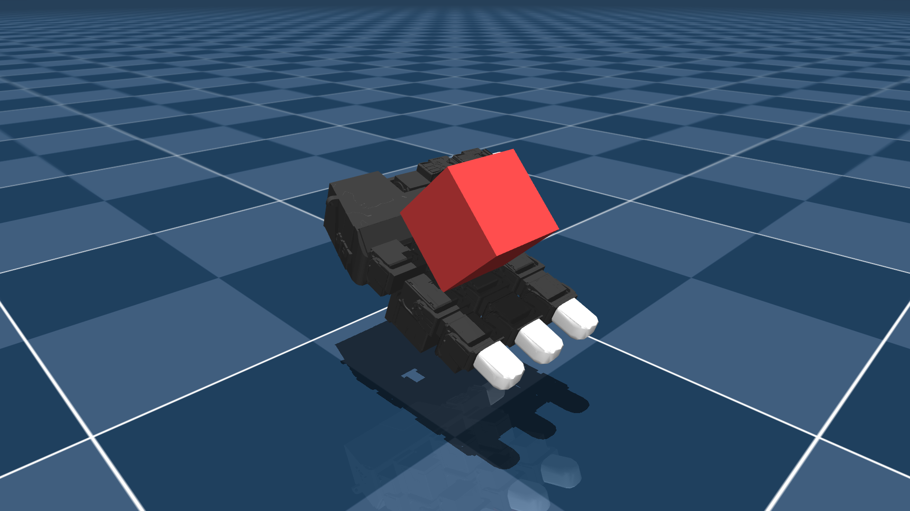

# Dexterous In-Hand Cube Reorientation

Goal-conditioned reinforcement learning system for in-hand 3D cube reorientation using a 16-DoF LEAP Hand in MuJoCo. Built with TorchRL, PyTorch, and Soft Actor-Critic (SAC) combined with Hindsight Experience Replay (HER) and Automatic Domain Randomization (ADR).

---

## Overview

In-hand dexterous manipulation is characterized by contact-rich dynamics, unilateral force constraints, and irreversible absorbing failure states when an object slips past the fingertips. This repository implements an end-to-end framework where a 16-DoF anthropomorphic LEAP Hand rotates an unattached 7 cm cube to match arbitrary target orientations in $SO(3)$ using pure sparse binary rewards.

### System Characteristics

* **Robot Hardware:** 16-DoF LEAP Hand (four fingers, four actuated joints per digit).
* **Object:** 6-DoF free-joint cube (7 cm width, 0.1 kg nominal mass).
* **Physics Engine:** MuJoCo (`mujoco-menagerie` assembly via `MjSpec`).
* **Control Hierarchy:** Low-level joint PD controller at 200 Hz; high-level RL policy queries at 20 Hz (decimation factor of 10).
* **Algorithm:** Off-policy Soft Actor-Critic (SAC) with clipped twin critics and automatic entropy temperature tuning.
* **Goal Relabeling:** Trajectory-based Hindsight Experience Replay (HER) relabeling with future achieved goals ($p = 0.80$).
* **Curriculum and Robustness:** Warmup curriculum from 1D planar yaw rotation to full 3D $SO(3)$ reorientation; automatic domain randomization across physics parameters and initial pose distribution.

---

## Simulation Environment

The simulation environment is assembled programmatically via MuJoCo's `MjSpec` API using the official LEAP Hand model from MuJoCo Menagerie.

### Key Kinematic and Physical Parameters

| Parameter | Value | Description |
| :--- | :--- | :--- |
| Hand Actuation | 16 DoF | Four revolute joints per finger (MCP roll, MCP pitch, PIP pitch, DIP pitch) |
| Palm Orientation | 20° Pitch Tilt | Downward palm inclination relative to horizontal, forming a gravity-assisted cradle |
| Physics Timestep | 0.005 s (200 Hz) | Stable numerical integration of unilateral frictional contacts |
| Policy Timestep | 0.050 s (20 Hz) | 10 simulation substeps executed per policy action step |
| Cube Dimensions | 0.070 m | 7 cm edge length (half-size $0.035\text{ m}$) |
| Cube Mass | 0.100 kg | Nominal mass with domain randomization support ($0.08\text{--}0.14\text{ kg}$) |
| Cube Surface Friction | [1.0, 0.005, 0.0001] | Sliding, torsional, and rolling friction coefficients |
| Drop Failure Threshold | $z < 0.04\text{ m}$ | Absorbing terminal threshold terminating the episode early |
| Maximum Episode Steps | 400 steps (20.0 s) | Extended horizon to allow multiple consecutive reorientations |

---

## Mathematical Formulation

### Observation Space (55 Dimensions)

At policy step $t$, the observation vector $s_t \in \mathbb{R}^{55}$ consists of:

$$\begin{aligned}
s_t = \big[ & q_{\text{hand}} \in \mathbb{R}^{16}, & & \text{Hand joint positions (rad)} \\
            & \dot{q}_{\text{hand}} \in \mathbb{R}^{16}, & & \text{Hand joint velocities (rad/s)} \\
            & p_{\text{cube}} \in \mathbb{R}^{3}, & & \text{Cube Cartesian position }(x, y, z)\text{ in meters} \\
            & q_{\text{cube}} \in \mathbb{R}^{4}, & & \text{Cube orientation unit quaternion } (w, x, y, z) \\
            & u_{t-1} \in \mathbb{R}^{16} \big] & & \text{Previous action vector applied to actuators}
\end{aligned}$$

### Action Space (16 Dimensions)

The actor produces normalized relative position targets $u_t \in [-1, 1]^{16}$. The low-level controller maps these into target joint positions:

$$q_{\text{target}} = q_{\text{nominal}} + \Delta q_{\text{scale}} \odot u_t$$

The low-level PD controller generates actuator torques at 200 Hz:

$$\tau = K_p (q_{\text{target}} - q) - K_d \dot{q}$$

where $K_p = 3.0$ and $K_d = 0.1$.

### $SO(3)$ Quaternion Geodesic Distance

Because antipodal quaternions represent identical 3D rotations ($q \equiv -q$), standard Euclidean distance ($L_2$ norm) is invalid. The geodesic angular distance on the Riemannian manifold $SO(3)$ is computed as:

$$\theta(q_{\text{achieved}}, q_{\text{desired}}) = 2 \arccos\left( \min\left(1.0 - \epsilon, \, \left\vert{} q_{\text{achieved}} \cdot q_{\text{desired}} \right\vert{} \right) \right)$$

where $\epsilon = 10^{-7}$ prevents gradient instability at numerical boundary conditions.

### Sparse Reward and Success Condition

A binary sparse reward is employed to eliminate reward-hacking behaviors:

$$r(s_t, g_{\text{desired}}) = \begin{cases} 0.0 & \text{if } \theta(q_{\text{achieved}}, q_{\text{desired}}) \le \theta_{\text{threshold}} \\ -1.0 & \text{otherwise} \end{cases}$$

The angular success threshold is set to $\theta_{\text{threshold}} = 0.15\text{ rad} \approx 8.59^\circ$. If the cube drops below the palm ($z_{\text{cube}} < 0.04\text{ m}$), the episode terminates with reward $-1.0$.

### Consecutive Multi-Goal Chaining

When the current target orientation is held within the tolerance threshold for 5 consecutive policy steps, the environment logs a successful orientation, resamples a fresh target quaternion $g' \sim SO(3)$, and continues the episode without resetting hand posture.
