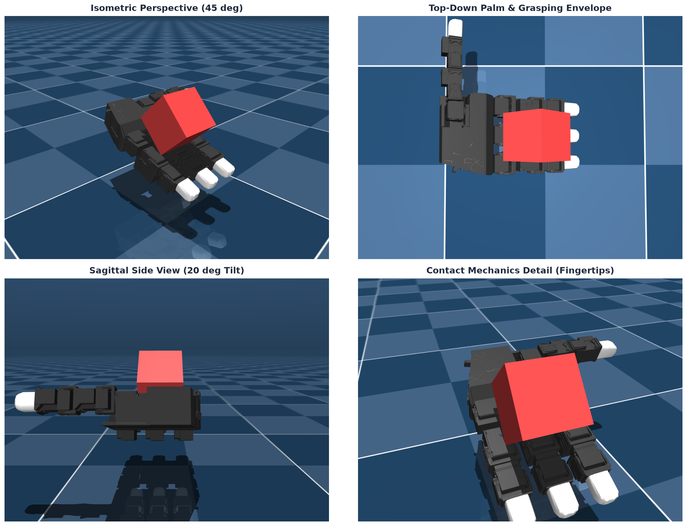
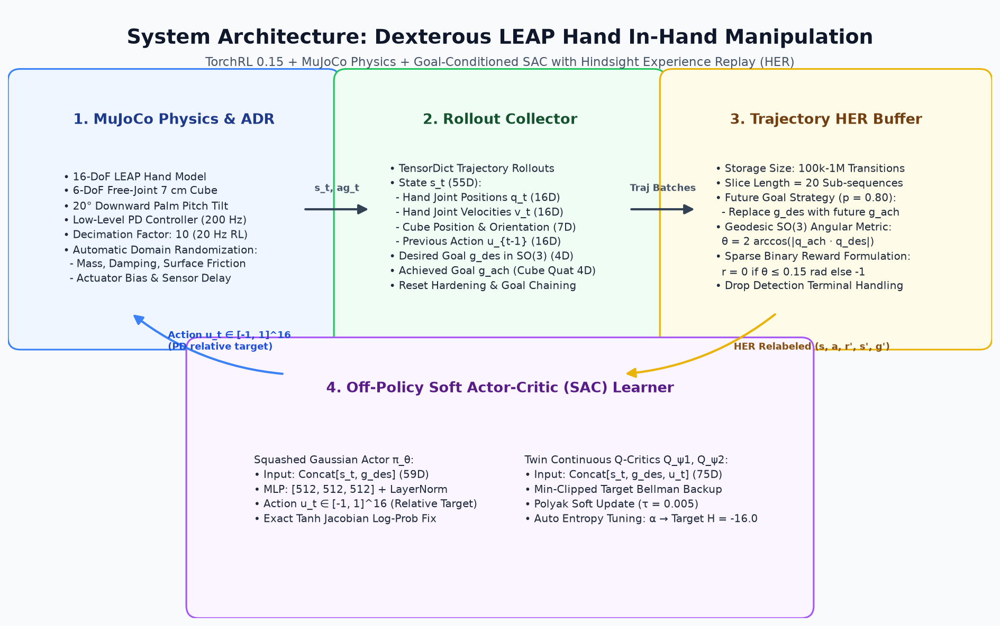
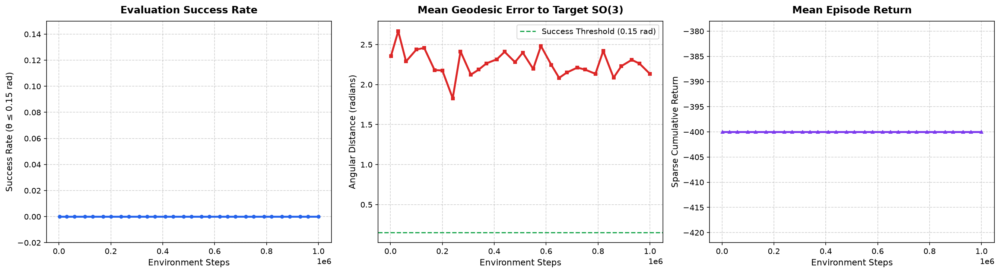

# Dexterous In-Hand Cube Reorientation

Goal-conditioned reinforcement learning system for in-hand 3D cube reorientation using a 16-DoF LEAP Hand in MuJoCo. Built with TorchRL, PyTorch, and Soft Actor-Critic (SAC) combined with Hindsight Experience Replay (HER) and Automatic Domain Randomization (ADR).


---

## Overview

In-hand dexterous manipulation is characterized by contact-rich dynamics, unilateral force constraints, and irreversible absorbing failure states when an object slips past the fingertips. This repository implements an end-to-end framework where a 16-DoF anthropomorphic LEAP Hand rotates an unattached 7 cm cube to match arbitrary target orientations in $SO(3)$ using pure sparse binary rewards.

### System Characteristics

* **Robot Hardware:** 16-DoF LEAP Hand (four fingers, four actuated joints per digit).
* **Object:** 6-DoF free-joint cube (7 cm width, 0.1 kg nominal mass).
* **Physics Engine:** MuJoCo (`mujoco-menagerie` assembly via `MjSpec`).
* **Control Hierarchy:** Low-level joint PD controller at 200 Hz; high-level RL policy queries at 20 Hz (decimation factor of 10).
* **Algorithm:** Off-policy Soft Actor-Critic (SAC) with clipped twin critics and automatic entropy temperature tuning.
* **Goal Relabeling:** Trajectory-based Hindsight Experience Replay (HER) relabeling with future achieved goals ($p = 0.80$).
* **Curriculum and Robustness:** Warmup curriculum from 1D planar yaw rotation to full 3D $SO(3)$ reorientation; automatic domain randomization across physics parameters and initial pose distribution.

---

## Simulation Environment

The simulation environment is assembled programmatically via MuJoCo's `MjSpec` API using the official LEAP Hand model from MuJoCo Menagerie.



### Key Kinematic and Physical Parameters

| Parameter | Value | Description |
| :--- | :--- | :--- |
| Hand Actuation | 16 DoF | Four revolute joints per finger (MCP roll, MCP pitch, PIP pitch, DIP pitch) |
| Palm Orientation | 20° Pitch Tilt | Downward palm inclination relative to horizontal, forming a gravity-assisted cradle |
| Physics Timestep | 0.005 s (200 Hz) | Stable numerical integration of unilateral frictional contacts |
| Policy Timestep | 0.050 s (20 Hz) | 10 simulation substeps executed per policy action step |
| Cube Dimensions | 0.070 m | 7 cm edge length (half-size $0.035\text{ m}$) |
| Cube Mass | 0.100 kg | Nominal mass with domain randomization support ($0.08\text{--}0.14\text{ kg}$) |
| Cube Surface Friction | [1.0, 0.005, 0.0001] | Sliding, torsional, and rolling friction coefficients |
| Drop Failure Threshold | $z < 0.04\text{ m}$ | Absorbing terminal threshold terminating the episode early |
| Maximum Episode Steps | 400 steps (20.0 s) | Extended horizon to allow multiple consecutive reorientations |

---

## System Architecture

The pipeline is organized into four decoupled components interfaced through TorchRL `TensorDict` structures:



1. **Physics and Domain Randomization Layer:** Evaluates multi-body contact dynamics and integrates the LEAP Hand and cube states. Low-level PD position tracking converts relative target joint angles to actuator torques at 200 Hz.
2. **Goal-Conditioned Rollout Collector:** Collects multi-step trajectories in parallel or single-worker configurations. Packages the 55-dimensional state, 4-dimensional achieved goal, and 4-dimensional target quaternion.
3. **Trajectory Hindsight Experience Replay Buffer:** Stores complete trajectories using sequential slicing (`slice_len = 20`). With 80% probability, future achieved orientations replace the original desired goal, transforming dropped or deflected trajectories into successful training experiences.
4. **Soft Actor-Critic Learner:** Optimizes an actor network with exact tanh squashing Jacobian corrections alongside twin clipped Q-critics with soft target updates and temperature parameter optimization.

---

## Mathematical Formulation

### Observation Space (55 Dimensions)

At policy step $t$, the observation vector $s_t \in \mathbb{R}^{55}$ consists of:

$$\begin{aligned}
s_t = \big[ & q_{\text{hand}} \in \mathbb{R}^{16}, & & \text{Hand joint positions (rad)} \\
            & \dot{q}_{\text{hand}} \in \mathbb{R}^{16}, & & \text{Hand joint velocities (rad/s)} \\
            & p_{\text{cube}} \in \mathbb{R}^{3}, & & \text{Cube Cartesian position }(x, y, z)\text{ in meters} \\
            & q_{\text{cube}} \in \mathbb{R}^{4}, & & \text{Cube orientation unit quaternion } (w, x, y, z) \\
            & u_{t-1} \in \mathbb{R}^{16} \big] & & \text{Previous action vector applied to actuators}
\end{aligned}$$

### Action Space (16 Dimensions)

The actor produces normalized relative position targets $u_t \in [-1, 1]^{16}$. The low-level controller maps these into target joint positions:

$$q_{\text{target}} = q_{\text{nominal}} + \Delta q_{\text{scale}} \odot u_t$$

The low-level PD controller generates actuator torques at 200 Hz:

$$\tau = K_p (q_{\text{target}} - q) - K_d \dot{q}$$

where $K_p = 3.0$ and $K_d = 0.1$.

### $SO(3)$ Quaternion Geodesic Distance

Because antipodal quaternions represent identical 3D rotations ($q \equiv -q$), standard Euclidean distance ($L_2$ norm) is invalid. The geodesic angular distance on the Riemannian manifold $SO(3)$ is computed as:

$$\theta(q_{\text{achieved}}, q_{\text{desired}}) = 2 \arccos\left( \min\left(1.0 - \epsilon, \, \left\vert{} q_{\text{achieved}} \cdot q_{\text{desired}} \right\vert{} \right) \right)$$

where $\epsilon = 10^{-7}$ prevents gradient instability at numerical boundary conditions.

### Sparse Reward and Success Condition

A binary sparse reward is employed to eliminate reward-hacking behaviors:

$$r(s_t, g_{\text{desired}}) = \begin{cases} 0.0 & \text{if } \theta(q_{\text{achieved}}, q_{\text{desired}}) \le \theta_{\text{threshold}} \\ -1.0 & \text{otherwise} \end{cases}$$

The angular success threshold is set to $\theta_{\text{threshold}} = 0.15\text{ rad} \approx 8.59^\circ$. If the cube drops below the palm ($z_{\text{cube}} < 0.04\text{ m}$), the episode terminates with reward $-1.0$.

### Consecutive Multi-Goal Chaining

When the current target orientation is held within the tolerance threshold for 5 consecutive policy steps, the environment logs a successful orientation, resamples a fresh target quaternion $g' \sim SO(3)$, and continues the episode without resetting hand posture.

---

## Reinforcement Learning Details

### Squashed Gaussian Actor with Exact Log-Prob Correction

The policy outputs unconstrained Gaussian parameters $(\mu, \log \sigma)$ and squashes samples through a tanh bijection: $u = \tanh(x)$. To maintain valid probability densities during policy optimization, the log-probability accounts for the diagonal Jacobian determinant:

$$\log \pi(u \mid s) = \log \mu(x \mid s) - \sum_{i=1}^{16} \log \left( 1 - \tanh^2(x_i) + \epsilon \right)$$

### Twin Clipped Critics

Twin Q-networks $Q_{\psi_1}(s, g, u)$ and $Q_{\psi_2}(s, g, u)$ mitigate overestimation bias by taking the minimum target prediction:

$$y_t = r_t + \gamma (1 - d_t) \left( \min_{j=1,2} Q_{\bar{\psi}_j}(s_{t+1}, g, \tilde{u}_{t+1}) - \alpha \log \pi_\theta(\tilde{u}_{t+1} \mid s_{t+1}, g) \right)$$

Target networks are updated via Polyak averaging:

$$\bar{\psi}_j \leftarrow \tau \psi_j + (1 - \tau) \bar{\psi}_j, \quad \tau = 0.005$$

### Automatic Temperature Adjustment

The entropy temperature $\alpha$ is tuned dynamically to match the target entropy $\mathcal{H}_0 = -\dim(\mathcal{A}) = -16.0$:

$$J(\alpha) = \mathbb{E}\left[ -\alpha \left( \log \pi_\theta(u \mid s, g) + \mathcal{H}_0 \right) \right]$$

---

## Domain Randomization and Reset Distribution

To prevent policies from exploiting specific simulator initial conditions, the environment incorporates domain randomization and pose perturbation:

1. **Palm Translation Offset:** Initial cube position perturbed by $\Delta x, \Delta y \sim \mathcal{U}(-0.015, 0.015)\text{ m}$.
2. **Initial Orientation Randomization:** Cube initial orientation sampled randomly across the unit sphere.
3. **Inertial and Frictional Perturbations:** Dynamic randomization of cube mass ($\pm 20\%$), sliding friction ($\pm 30\%$), and actuator bias.
4. **Curriculum Warmup:** Optional training phase restricting targets to planar yaw rotations before transitioning to full $SO(3)$ targets.

---

## Training Performance and Dynamics

Evaluation metrics tracked over training steps:



* **Success Rate:** Measures the fraction of evaluation trajectories reaching orientation accuracy within $0.15\text{ rad}$.
* **Geodesic Angular Error:** Tracks mean rotation distance between achieved and desired orientations throughout rollout execution.
* **Checkpoint Retention:** Best performing weights are continuously serialized alongside full training states and ONNX deployment graphs.

---

## Repository Structure

```
.
├── assets/
│   ├── simulation_environment.png    # Primary MuJoCo simulation render
│   ├── simulation_multiview.png      # 4-angle kinematic and contact mechanics panel
│   ├── system_architecture.png       # Complete reinforcement learning architecture
│   └── training_curves.png           # Evaluation metrics over training frames
├── checkpoints/
│   ├── best_model.pt                 # Highest-performing policy checkpoint
│   ├── best_policy.onnx              # Standalone ONNX policy graph
│   └── metrics_summary.json          # Serialized training and evaluation log
├── docs/
│   ├── project.md                    # Engineering design notes and mathematical derivations
│   └── superpowers/plans/            # Technical implementation plans
├── scripts/
│   └── generate_figures.py           # Offscreen figure generation script
├── src/
│   ├── algo/
│   │   ├── actor.py                  # Squashed Gaussian actor with exact Jacobian correction
│   │   ├── checkpoint.py             # Checkpoint serialization and ONNX export routines
│   │   ├── collector.py              # TorchRL rollout collection interfaces
│   │   ├── critic.py                 # Twin continuous Q-critics
│   │   ├── evaluation.py             # Deterministic evaluation and goal-chaining metrics
│   │   ├── her.py                    # Hindsight experience replay buffer construction
│   │   └── sac_trainer.py            # SAC loss computation and parameter updates
│   ├── envs/
│   │   ├── domain_randomization.py   # ADR controller and parameter perturbation
│   │   ├── leap_cube_env.py          # TorchRL environment wrapper for LEAP Hand + Cube
│   │   ├── pd_controller.py          # Low-level joint PD controller (200 Hz)
│   │   └── spec.py                   # MjSpec assembly of LEAP Hand and cube
│   └── utils/
│       └── quaternion.py             # Geodesic SO(3) distance and quaternion operations
├── tests/                            # 106 unit and integration tests
├── main.py                           # Extended horizon and multi-target demonstration
├── train.py                          # Distributed/single-worker training script
├── visualize.py                      # Interactive MuJoCo simulation viewer
├── pyproject.toml                    # Project metadata and dependencies
└── README.md
```

---

## Installation

### Prerequisites

* Linux (x86_64)
* Python 3.14+ (or Python 3.12+ with compatible virtual environment)
* MuJoCo 3.4+

### Setting Up the Environment

Using `uv` or standard Python virtual environment:

```bash
# Clone the repository
git clone https://github.com/UBU11/dex.git
cd dex

# Create and activate virtual environment
python3 -m venv .venv
source .venv/bin/activate

# Install package dependencies
pip install -e .
```

### Key Dependencies

* `torch>=2.15.0`
* `torchrl>=0.15.0`
* `tensordict>=0.15.2`
* `mujoco>=3.4.0`
* `mujoco-menagerie>=2026.9.0`
* `onnx>=1.23.2`

---

## Usage

### 1. Interactive MuJoCo Viewer

Launch the real-time interactive physics viewer to inspect hand kinematics, contact points, and cube physics:

```bash
# Passive zero-action mode
python visualize.py --checkpoint none

# Evaluate trained checkpoint
python visualize.py --checkpoint checkpoints/best_model.pt --target-mode so3

# Export standalone MuJoCo XML model
python visualize.py --checkpoint none --export-xml assets/leap_cube_assembled.xml
```

Viewer controls:
* **Space:** Pause / Unpause physics simulation.
* **Backspace:** Reset simulation state to home keyframe.
* **Right Mouse Drag:** Orbit camera.
* **Left Mouse Drag:** Perturb or apply external forces to hand joints and cube.
* **Scroll Wheel:** Zoom camera in / out.

### 2. Multi-Target Chaining Demonstration

Run the verification script showcasing reset distribution hardening, consecutive goal sampling, and trajectory replay:

```bash
python main.py
```

### 3. Training

Train the agent from scratch or resume from a checkpoint:

```bash
# Standard training run on CPU
python train.py --total-frames 1000000 --batch-size 256 --device cpu

# Training with GPU acceleration and 4 parallel collection workers
python train.py --total-frames 1000000 --batch-size 256 --device cuda --num-workers 4

# Training with curriculum warmup (first 200,000 frames on planar yaw targets)
python train.py --warmup-yaw-frames 200000 --total-frames 1000000

# Resume from existing checkpoint
python train.py --resume checkpoints/checkpoint_step_500000.pt
```

### 4. Running the Test Suite

Execute the test suite covering kinematics, quaternion mathematics, HER relabeling, Jacobian corrections, and ADR transitions:

```bash
pytest tests/ -v
```

---

## Standalone ONNX Deployment

The trained policy is exported directly to an ONNX computation graph (`checkpoints/best_policy.onnx`). It accepts a 59-dimensional input tensor (concatenation of 55D state and 4D target quaternion) and outputs deterministic 16-dimensional relative joint targets without requiring PyTorch at runtime:

```python
import numpy as np
import onnxruntime as ort

session = ort.InferenceSession("checkpoints/best_policy.onnx")
input_name = session.get_inputs()[0].name
output_name = session.get_outputs()[0].name

# Example: 55-dimensional observation + 4-dimensional target quaternion
dummy_obs_and_goal = np.zeros((1, 59), dtype=np.float32)
action = session.run([output_name], {input_name: dummy_obs_and_goal})[0]
print("Computed joint action shape:", action.shape)
```
